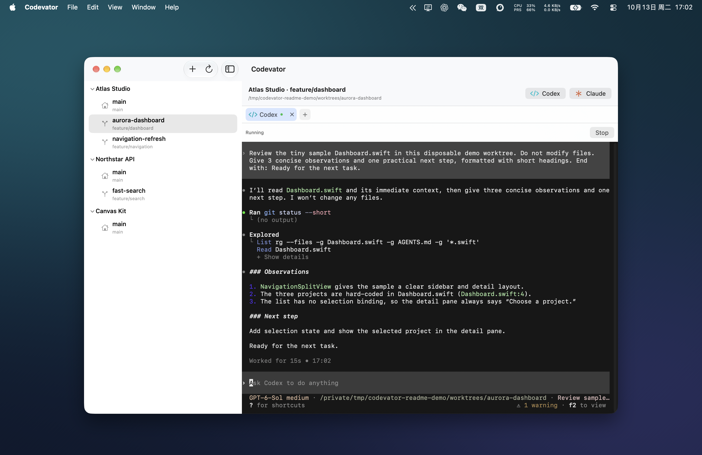
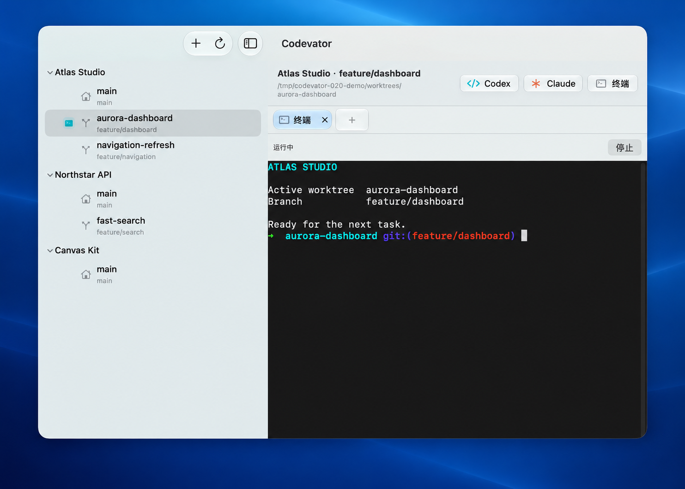

<p align="center">
  
</p>

<h1 align="center">Codevator</h1>

<p align="center">Your projects, worktrees, and coding conversations in one Mac app.</p>

<p align="center"><a href="README-zh.md">简体中文</a></p>

Codevator gives each coding task its own place. Keep your Git projects and worktrees in the sidebar, then open Codex, Claude Code, or a regular terminal in the worktree you're using. Switch to another project whenever you need to; your open tabs keep running.

<p align="center">
  
</p>

On macOS 26, Liquid Glass gives the sidebar, toolbar, and tabs a translucent look. The terminal keeps its dark background so conversations stay easy to read. This view uses sample projects and a presentation backdrop.

<p align="center">
  
</p>

## What you can do

- **Move between projects without losing your place.** See your projects and their worktrees in the sidebar. A worktree is a separate working folder for the same Git project, so you can work on another branch without disturbing your main folder.
- **Give each task its own tab.** Open Codex, Claude Code, or a regular terminal in the selected worktree. Open more than one tab, even in the same worktree, and return to them later.
- **See where you left a session running.** A terminal icon marks worktrees with open tabs. In Codex and Claude Code tabs, green shows a prompt waiting for a reply; orange shows a reply that finished while you were elsewhere and has not been viewed yet. Both can appear beside the same worktree or project. Codevator can play a sound when a reply finishes and, if you allow notifications, alert you when it finishes in the background.
- **Create worktrees from the sidebar.** Start from a local or remote branch, or make a new one. Codevator suggests a folder name, and you can change it before creating the worktree.

## Get started

You need macOS 14 or later and Git. A regular terminal works without installing an AI tool. To use Codex or Claude Code, install its command-line app on your Mac and sign in through that tool.

1. Get the disk image from [Releases](https://github.com/LaughingVzr/Codevator/releases), open it, and drag Codevator into Applications. The app uses an ad-hoc signature and is not notarized, so macOS may ask you to review it before opening.
2. Click **+** in the sidebar, or press **⌘O**, and choose a local Git project.
3. Select a worktree and click **Codex**, **Claude**, or **Terminal** to open a tab. You can also open a blank tab and choose what to run later.

To add another worktree, right-click a project in the sidebar and choose **Create worktree**. The form starts with existing local and remote branches. It refreshes the remote list when opened, and you can refresh it again in the form. Choose **Create new branch** if you need one.

Codevator looks for `codex` and `claude` on your Mac. If either tool is installed in an unusual location, set its path in **Codevator → Settings → Coding Tools**. The regular terminal uses your Mac's shell.

This README describes the current source code. A downloadable release may not include changes made since it was published. Release packages target both Apple silicon and Intel Macs; Intel hardware has not yet been tested directly.

## Good to know

- Switching projects or tabs leaves their sessions running. Codevator asks before closing a running tab or quitting while sessions are still running.
- Your projects and selected worktree are remembered when you reopen the app. Running sessions and terminal history are not restored after quitting.
- Codevator only removes a worktree when it is not the main one and has no running session or changes and new files waiting to be committed. Removing a project from the sidebar leaves its files on disk, but stops its open sessions after you confirm.
- Codex and Claude Code still handle their own sign-in and command approvals. Codevator does not approve commands for them.

<details>
<summary>Build and test from source</summary>

Install Xcode, then open `Codevator.xcodeproj`, select the **Codevator** scheme and **My Mac**, and click **Run**. Or use the Makefile:

```sh
make build
make test
```

Run `make test-ui` for macOS interface tests. If Xcode is installed outside `/Applications/Xcode.app`, set `XCODEBUILD` to its `xcodebuild` path.

</details>

## License

Codevator is released under the [MIT License](LICENSE). You may modify and use it commercially; keep the copyright and license notice with copies or substantial portions of the software.
