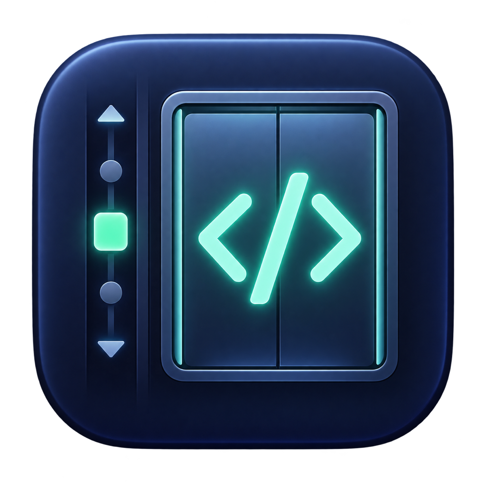

<p align="center">
  
</p>

<h1 align="center">Codevator</h1>

<p align="center">A home for your projects, worktrees, and coding conversations on Mac.</p>

<p align="center"><a href="README-zh.md">简体中文</a></p>

Codevator helps you move between coding tasks without losing your place. Keep your Git projects and worktrees in the sidebar, then open Codex or Claude Code in a separate tab for each task. Your conversations keep running while you switch projects or tabs.

> Codevator is in active development. You can build and try it today, but there is no packaged release yet.

## What you can do

- **See all your work in one place.** Add local Git projects and browse their worktrees from the sidebar. A worktree is another working folder for the same project, useful when you want to work on a different branch without disturbing your main folder.
- **Start a conversation where the code lives.** Open Codex or Claude Code in the selected worktree. Each tab has its own conversation, and you can keep several tabs open at once.
- **Know when a reply is ready.** Finished conversations show an indicator on the tab and beside the related worktree and project. Codevator can also send a macOS notification.

Codevator runs the coding tools installed on your Mac. It does not include Codex or Claude Code, and you sign in through each tool as usual.

## Get started

You'll need macOS 14 or later, Git, and Xcode. Install Codex or Claude Code separately if you want to use it in Codevator.

1. Clone this repository and open `Codevator.xcodeproj` in Xcode.
2. Select the **Codevator** scheme and **My Mac**, then click **Run**.
3. In the app, click **+** in the sidebar (or press **⌘O**) and choose a local Git project.
4. Select a worktree and click **Codex** or **Claude** to start a tab. You can also create a blank tab first and choose a tool later.

To create another worktree, right-click a project in the sidebar. Codevator can use an existing branch or create a new one, and it suggests a name that you can change.

Codevator looks for `codex` and `claude` on your Mac. If a tool is installed somewhere else, you can set its path in **Codevator → Settings → Coding Tools**.

## Good to know

- Switching projects or tabs keeps conversations running. Closing a running tab or quitting the app asks before stopping its process.
- Codevator remembers your projects and selected worktree between launches. It does not yet restore running conversations or terminal history after quitting.
- Worktree removal is limited to clean, inactive worktrees. Removing a project from the sidebar does not delete its files.
- The app keeps the tools' own sign-in and approval flows. It does not automatically approve commands for them.

For earlier implementation and test notes, see the [development record](docs/implementation-status.md).

<details>
<summary>Build and test from Terminal</summary>

```sh
xcodebuild -project Codevator.xcodeproj -scheme Codevator \
  -derivedDataPath .build/CodevatorDerivedData \
  -skipPackagePluginValidation -disableAutomaticPackageResolution build

xcodebuild -project Codevator.xcodeproj -scheme Codevator \
  -derivedDataPath .build/CodevatorDerivedData \
  -skipPackagePluginValidation -disableAutomaticPackageResolution \
  -only-testing:CodevatorTests test
```

</details>

## License

Codevator is released under the [MIT License](LICENSE). You may modify and use it commercially; keep the copyright and license notice with copies or substantial portions of the software.
