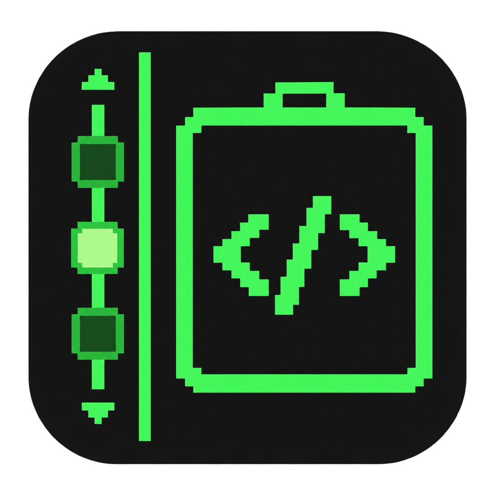

# 图标备选方案

使用内置 image_gen 生成，供用户选型；当前安装图标未替换。B 为浅色不透明概念预览，选定后再制作正式图标资源。

## A 极简扁平

生成提示词：

Use case: logo-brand. Create ONE production app icon for Code Elevator, native multi-project/worktree coding workspace manager. The coding function must be dominant; left-side project navigation behaves like an elevator between floors. A minimal flat geometric macOS icon. Matte midnight navy rounded-square tile, mint code glyph </> large on the right inside an understated elevator door outline. Left quarter: three simple floor markers on a vertical rail, middle stop mint, tiny up/down arrowheads. Flat vector-like precision, no glow, no bevel, no texture. Bold compact shapes and immaculate negative space. Straight-on square icon only, no presentation mockup, no labels, no captions, no watermark. 1024x1024 composition, icon tile about 84% of canvas, transparent background outside rounded square. Strong readability at 32px. Keep the code glyph accurate as </>. Output only one icon.

## B 浅色玻璃

生成提示词：

Use case: logo-brand. Create one clean premium light frosted-glass app icon concept for Code Elevator. Square full-bleed opaque pale ice-blue background with a large pearl-white rounded-square icon tile inset about 8%. On right, translucent blue elevator double doors bearing a large bold deep cobalt </> code symbol. On left, a slim cobalt elevator rail with three simple floor stops, middle illuminated cyan, tiny up/down arrows. Coding symbol dominates. Airy minimal macOS aesthetic, softly dimensional glass, gentle shadows, smooth large shapes, absolutely clean polished surfaces and borders. Solid opaque backdrop, no transparency, no noisy textures, no distressed edges, no paint splatters, no grain, no flecks, no words, no letters, no labels, no watermark. Straight-on icon-only concept preview, 1024x1024.

## C 复古终端

生成提示词：

Use case: logo-brand. Create ONE production app icon for Code Elevator, native multi-project/worktree coding workspace manager. The coding function must be dominant; left-side project navigation behaves like an elevator between floors. A retro terminal-inspired macOS icon. Charcoal-black rounded-square tile. Bold phosphor-green pixel-inspired </> code glyph within a simple elevator cabin rectangle on right. Left quarter a green elevator rail with three chunky floor stops, middle selected, tiny pixel up/down arrows. Clean 8-bit geometry with restrained CRT character, strong legibility, almost flat, no text or screen full of code, no exaggerated neon. Straight-on square icon only, no presentation mockup, no labels, no captions, no watermark. 1024x1024 composition, icon tile about 84% of canvas, transparent background outside rounded square. Strong readability at 32px. Keep the code glyph accurate as </>. Output only one icon.

## D 几何标志

生成提示词：

Use case: logo-brand. Create ONE production app icon for Code Elevator, native multi-project/worktree coding workspace manager. The coding function must be dominant; left-side project navigation behaves like an elevator between floors. A sophisticated geometric monogram macOS icon. Warm burnt-orange rounded-square tile with ivory geometric symbol. Integrate a large code bracket pair < > with a vertical slash into a compact elevator-like architectural monogram, dominant coding signal. A slim ivory left vertical rail and three short horizontal floor bars, one slightly extended active car stop, up/down direction suggested through bracket cuts. Bold graphic identity, editorial Swiss design, flat matte finish, very few shapes, no words. Straight-on square icon only, no presentation mockup, no labels, no captions, no watermark. 1024x1024 composition, icon tile about 84% of canvas, transparent background outside rounded square. Strong readability at 32px. Keep the code glyph accurate as </>. Output only one icon.
